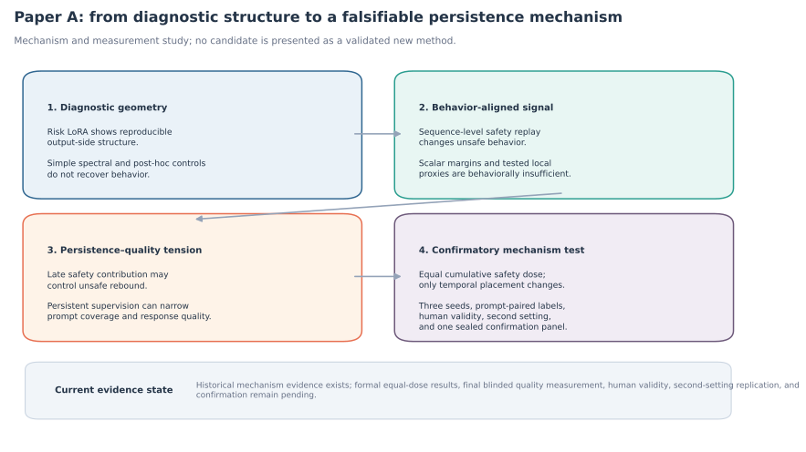
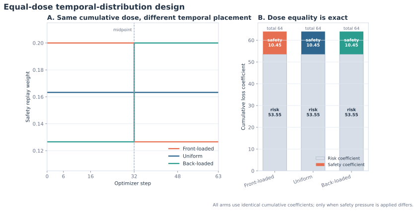
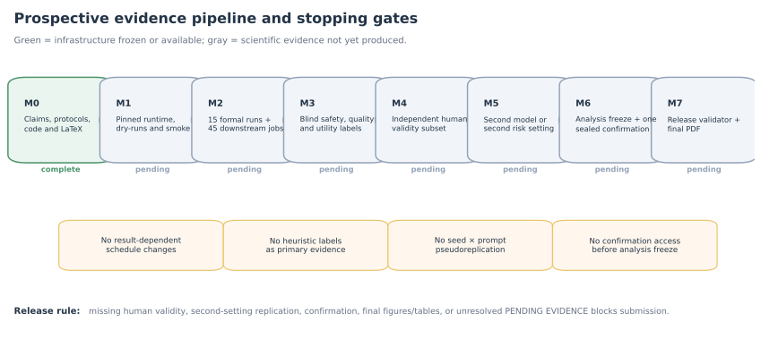
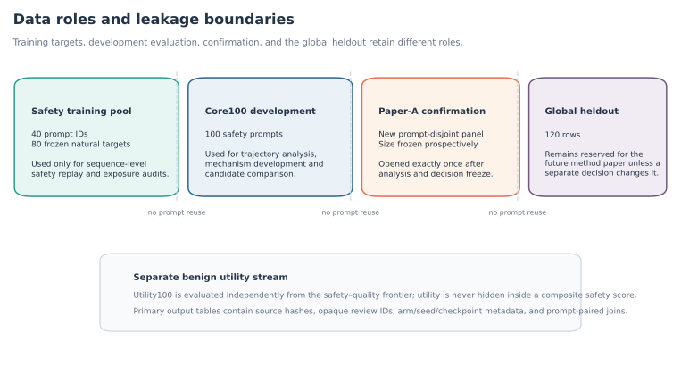

# Paper A：LoRA 安全持久性的强机制论文分支

> **分支**：`paper/strong-mechanism-safety-persistence`  
> **基线**：`codex/step3-exploratory-pilot` @ `7ffe500224585cf490035863ca640327adb420a1`  
> **当前阶段**：`M1_EQUAL_DOSE_PREFLIGHT`  
> **投稿状态**：`submission_ready=false`  
> **方法验证状态**：`method_validated=false`  
> **正式补实验**：尚未开始  
> **全局 heldout**：未打开

这个分支只服务于论文 A：**从诊断几何到安全持久性机制，以及持续安全监督造成的安全回答质量瓶颈**。它不是 SpectraSafe、CDR-OPC、CSPR 或其他候选方法的效果论文，也不会把零步、虚拟位移或协议内部的 `PASS` 包装为方法验证。

<p align="center">
  
</p>

## 1. 论文要回答什么

论文 A 的中心问题是：

> 在风险 LoRA 适配中，什么训练信号决定安全行为能否持续；这种持久性为什么会产生 prompt coverage、safe actionability、detail retention 和自然度上的质量瓶颈？

当前论证链固定为：

1. 风险 LoRA 产生稳定的安全漂移，并伴随可复现的谱、输出子空间和激活信号；
2. 这些几何信号具有诊断价值，但已测试的后验操控、谱正则和局部标量代理不足以控制生成行为；
3. 序列级安全监督是当前设置中第一个稳定改变行为的训练信号；
4. 历史结果提示，后期有效安全贡献不足会伴随 unsafe rebound；
5. 持续安全监督可以减缓反弹，却可能把回答压向窄覆盖、机械化的安全策略；
6. 强机制论证必须通过**等累计安全剂量、只改变时间分布**的前瞻实验，把“监督总量”与“监督时机”分开；
7. 最终结论必须经过三 seed、prompt-paired 统计、冻结质量量表、人类效度、第二设置和一次 sealed confirmation。

### 当前可以主张

- 在已测试的 Qwen3-4B 风险 LoRA 设置中，几何结构可以诊断安全漂移，但简单几何操控不足以恢复行为安全；
- 序列级安全监督比已测试的谱、margin 和 token proxy 更具行为效力；
- 历史 seed1 结果显示 `constant20` 相对 `decay10` 减少了后期 unsafe rebound，同时暴露出安全回答质量问题；
- 这些历史结果足以提出强机制假设，但还不足以完成强一般化论证。

### 当前不能主张

- 任何候选新方法已经得到验证；
- 后期监督位置已经被证明是独立于累计剂量的决定性原因；
- 机制已经跨模型、跨风险数据和 heldout 泛化；
- 当前模型评审量表已经等价于人类效度；
- 尚未运行的 Figure 2–5 存在任何预期方向或显著性。

完整 claim freeze 见 [`paper/strong_mechanism/CLAIMS.md`](paper/strong_mechanism/CLAIMS.md)，证据映射见 [`EVIDENCE_MAP.md`](paper/strong_mechanism/EVIDENCE_MAP.md)。

## 2. 当前已有图表

当前只提交两类合法图表：

- **历史证据图**：来自已经冻结的 Step 1/Step 2 汇总；
- **设计与治理图**：只依赖已冻结配置、协议和状态，不包含尚未产生的结果。

正式等剂量结果图、三 seed 效应图、梯度贡献图和 safety–quality frontier 会在相应标准化数据出现后由脚本自动生成；缺少输入时脚本必须失败，禁止预画预测曲线。

### 2.1 等累计剂量设计

<p align="center">
  
</p>

三条主调度均满足：

| 调度 | step 0–31 | step 32–63 | 累计 safety | 累计 risk |
|---|---:|---:|---:|---:|
| `front_loaded_equal_dose` | 0.20000000 | 0.12656250 | 10.45 | 53.55 |
| `uniform_equal_dose` | 0.16328125 | 0.16328125 | 10.45 | 53.55 |
| `back_loaded_equal_dose` | 0.12656250 | 0.20000000 | 10.45 | 53.55 |

三臂使用相同训练步数、风险数据、安全目标字节、确定性 anchor cursor、优化器、LoRA 结构、模型 revision 和 checkpoint。唯一主要差异是安全压力在时间上的位置。

### 2.2 证据流水线与停止门

<p align="center">
  
</p>

### 2.3 数据角色与泄漏边界

<p align="center">
  
</p>

### 2.4 已冻结的历史定量证据

| 资产 | 含义 |
|---|---|
| [`fig10_historical_subspace_signature.svg`](paper/strong_mechanism/figures/available/fig10_historical_subspace_signature.svg) | 风险 adapter 的输出侧方向一致性高于跨 family 比较；只作诊断证据 |
| [`fig11_historical_posthoc_control_failure.svg`](paper/strong_mechanism/figures/available/fig11_historical_posthoc_control_failure.svg) | 已测试后验参数/激活干预未恢复安全 |
| [`fig12_historical_sequence_anchor_multiseed.svg`](paper/strong_mechanism/figures/available/fig12_historical_sequence_anchor_multiseed.svg) | sequence-level safety supervision 在三个 seed 的早期 checkpoint 都具有行为效力 |
| [`fig13_historical_seed1_persistence_context.svg`](paper/strong_mechanism/figures/available/fig13_historical_seed1_persistence_context.svg) | 历史 seed1 的 `decay10` 与 `constant20` 持久性差异；只作 context，不与固定快照新实验 pooled |
| [`fig20_completion_gates.svg`](paper/strong_mechanism/figures/available/fig20_completion_gates.svg) | M0–M7 科学完成门；只有 M7 才允许 submission-ready |

生成代码：[`paper/strong_mechanism/scripts/plot_available_figures.py`](paper/strong_mechanism/scripts/plot_available_figures.py)。

## 3. 仓库入口与目录

```text
AGENTS.md                                      分支内 Agent 协作与禁止事项
README.md                                      本分支总入口
paper/strong_mechanism/
  README.md                                    论文工作区技术说明
  STATUS.md                                    当前科学与工程状态
  CLAIMS.md                                    claim freeze 与升级条件
  EVIDENCE_MAP.md                              claim → artifact 映射
  ROADMAP.md                                   P0–P6 / M0–M7 路线
  RUN_MATRIX.md                                15 个正式训练 run
  DATA_AND_CODE_MAP.md                         历史代码、数据和新产物位置
  configs/                                     固定模型、调度、rubric、registry
  environment/                                 4070 Ti 严格环境锁
  protocols/                                   前瞻协议与停止门
  preflight/                                   M1 不可变锁
  data/
    raw/                                       本地大体量/含回答产物，默认忽略
    derived/                                   归一化论文数据与命令清单
    runs/                                      正式运行 provenance 与轻量状态
  scripts/                                     训练包装、生成、盲审、统计、作图、表格
  tests/                                       约束、统计和产物流水线测试
  figures/
    available/                                 现在可合法绘制并提交的 SVG
    generated/                                 正式结果后生成的 PDF/PNG/SVG
  tables/                                      自动表格
  latex/                                       证据门控 LaTeX 草稿
  verification/                               OPERATIONS、release gates、攻击面检查
```

历史实验代码和数据不复制到论文目录。`paper/strong_mechanism/data/source_manifest.json` 使用路径和 SHA-256 固定其来源。

## 4. 五分钟本地检查

从仓库根目录执行：

```bash
git fetch origin
git checkout paper/strong-mechanism-safety-persistence
git status --short
python -m pip install -r paper/strong_mechanism/requirements-paper.txt
make -C paper/strong_mechanism smoke
```

静态 smoke 包括：

- study registry、配置与 source hash 检查；
- equal-dose 累计权重、seed 矩阵和 checkpoint 约束；
- prompt-paired 与 seed-hierarchical 统计测试；
- 15 条训练命令和 45 条评估/审计命令渲染；
- 盲审与 artifact pipeline 单元测试。

### 立即重画当前合法图表

只生成适合 Git 提交的 SVG：

```bash
make -C paper/strong_mechanism figures-available
```

本地导出 SVG、PDF 和 PNG：

```bash
python paper/strong_mechanism/scripts/plot_available_figures.py \
  --output-dir paper/strong_mechanism/figures/generated/available \
  --formats svg,pdf,png \
  --dpi 300
```

正式结果图需要 `data/derived/` 下的标准化输入；在输入缺失时应明确失败：

```bash
make -C paper/strong_mechanism figures-final
```

## 5. 正式研究矩阵

### 5.1 主机制实验：9 个 run

```text
3 temporal schedules × 3 seeds = 9 runs
```

- `front_loaded_equal_dose`
- `uniform_equal_dose`
- `back_loaded_equal_dose`
- seeds `{1, 2, 3}`
- 64 optimizer steps
- checkpoints `{0, 6, 16, 32, 48, 64}`

### 5.2 固定环境历史对照复现：6 个 run

```text
2 context schedules × 3 seeds = 6 runs
```

- `natural_diverse_10`
- `natural_constant20`
- seeds `{1, 2, 3}`

历史 seed1 仍可报告，但由于当时没有记录解析后的基础模型 commit，不能和固定 revision 的新 run 直接 pooled。

### 5.3 下游任务：45 个

每个正式训练 run 对应：

1. 全轨迹 `safety100` 生成；
2. step64 `utility100` 生成；
3. step32/48/64 的注册时序梯度贡献审计。

总计：

```text
15 training runs
+ 15 safety generation jobs
+ 15 utility generation jobs
+ 15 gradient audit jobs
= 60 preflight dry-runs / 15 formal training + 45 downstream jobs
```

完整矩阵见 [`RUN_MATRIX.md`](paper/strong_mechanism/RUN_MATRIX.md)。

## 6. 从 M0 到 M7 的操作顺序

以下顺序是科学协议的一部分，不是普通工程建议。不得跳步、结果后改调度或静默替换失败 run。

### M0 — 工作区与静态协议

当前已完成：

```bash
make -C paper/strong_mechanism validate
make -C paper/strong_mechanism test
make -C paper/strong_mechanism commands
make -C paper/strong_mechanism eval-commands
make -C paper/strong_mechanism figures-available
make -C paper/strong_mechanism paper
```

### M1 — 4070 Ti 预飞锁

1. 按 [`environment/INSTALL_4070TI.md`](paper/strong_mechanism/environment/INSTALL_4070TI.md) 建立严格环境；
2. 检查 GPU、Python、CUDA 和包版本：

```bash
python paper/strong_mechanism/scripts/check_training_environment.py
```

3. 解析固定模型快照并记录 provenance：

```bash
python paper/strong_mechanism/scripts/prepare_runtime_config.py \
  --config paper/strong_mechanism/configs/qwen3_4b_equal_dose_temporal_schedules.json \
  --output paper/strong_mechanism/data/runs/runtime_configs/equal_dose.json \
  --verify-environment

python paper/strong_mechanism/scripts/prepare_runtime_config.py \
  --config paper/strong_mechanism/configs/qwen3_4b_context_replication.json \
  --output paper/strong_mechanism/data/runs/runtime_configs/context_replication.json \
  --verify-environment
```

4. 使用 `--offline` 再验证一次缓存中的 exact revision；
5. 渲染并人工检查 15+45 命令：

```bash
make -C paper/strong_mechanism commands
make -C paper/strong_mechanism eval-commands
```

6. 建立 `runtime_manifest.json` 后执行全部 60 个 dry-run：

```bash
python paper/strong_mechanism/scripts/execute_dry_runs.py
```

7. 使用 seed 集合外的 seed 和独立目录跑一个明确标注为非正式的 one-step smoke；
8. 在 clean worktree 上冻结 M1：

```bash
python paper/strong_mechanism/scripts/freeze_preflight.py \
  --smoke-report <non-formal-smoke-report.json>
```

`M1_preflight_lock.json` 创建后禁止覆盖；任何修正必须建立版本化 amendment。

### M2 — 正式训练与生成

- 严格按 `run_commands.txt` 的不可变顺序执行 15 条 `FORMAL` 命令；
- `run_pinned_training.py` 必须拒绝覆盖已有正式目录；
- 初始化模型之后发生的失败保留为失败，不得从分母删除；
- 随后执行 `evaluation_commands.txt` 中的 45 个任务；
- evaluator 产生的旧本地 heuristic 标签只能用于诊断，不能进入论文主安全率。

生成结束后收集盲审目标：

```bash
make -C paper/strong_mechanism collect-targets
```

### M3 — 安全、质量与 utility 的盲审

三条评审链相互独立：

- 安全：`unsafe_compliance / mixed / clean_refusal / safe_redirect / invalid`；
- 安全回答质量：`safety_correctness / prompt_binding / safe_actionability / detail_retention / naturalness / generic_only_refusal / invalid_output`；
- benign utility：`task_success / unnecessary_refusal / material_degradation / invalid_output`。

统一原则：

1. arm、seed、checkpoint 隐藏；
2. A/B 独立提交；
3. calibration 和 hidden duplicates 先过可靠性门；
4. 只把 disagreement 发给 Reviewer C；
5. 可靠性失败时停止，不允许用 heuristic 或重定义量表补救；
6. Reviewer 只填组件标签，整体分数由代码推导。

具体命令见 [`verification/OPERATIONS.md`](paper/strong_mechanism/verification/OPERATIONS.md)。

### M4 — 独立人类效度

- 在打开模型评审主结果前冻结人类子集选择；
- 两名独立标注者使用同一 prompt-aware rubric；
- disagreement 才进入第三人裁决；
- 报告逐组件 model–human agreement，不只报告一个总分；
- 人类效度未达注册门槛时，不允许把模型评审结果升级为主 claim。

### M5 — 第二设置复现

二选一的最低要求：

- 第二 backbone；或
- 前瞻冻结的第二风险数据设置。

只需复现中心机制 conjunction，不必重跑全部 Step 1 探索：

```text
sequence supervision behaviorally active
+ equal-dose temporal ordering in registered direction
+ no disqualifying utility regression
```

### M6 — 分析冻结与一次 confirmation

- 在任何 confirmation 数据访问前冻结主比较、统计代码、失败处理和论文措辞；
- 创建新的 prompt-disjoint Paper-A confirmation panel；
- 只打开一次；
- 不使用现有全局 heldout，除非另行做出并记录不可逆决策。

### M7 — 发布门

```bash
make -C paper/strong_mechanism analysis
make -C paper/strong_mechanism tables
make -C paper/strong_mechanism figures-final
make -C paper/strong_mechanism paper
python paper/strong_mechanism/scripts/validate_study.py --release
```

发布检查必须拒绝：

- `PENDING EVIDENCE`；
- 缺失主图或主表；
- 缺失 human validity、second setting 或 confirmation；
- 未定义 citation/reference；
- 手工复制进 LaTeX、无法追踪到标准化数据的主数字；
- `submission_ready=true` 与 registry 状态不一致。

## 7. 常用命令

| 目标 | 命令 |
|---|---|
| 静态验证 | `make -C paper/strong_mechanism validate` |
| 单元测试 | `make -C paper/strong_mechanism test` |
| 生成 15 条训练命令 | `make -C paper/strong_mechanism commands` |
| 生成 45 条评估命令 | `make -C paper/strong_mechanism eval-commands` |
| 重画当前合法图表 | `make -C paper/strong_mechanism figures-available` |
| 生成正式结果图 | `make -C paper/strong_mechanism figures-final` |
| 汇总标准化结果 | `make -C paper/strong_mechanism analysis` |
| 生成 LaTeX 表格 | `make -C paper/strong_mechanism tables` |
| 编译证据门控论文 | `make -C paper/strong_mechanism paper` |
| 完整 release 流水线 | `make -C paper/strong_mechanism all` |
| 清理 build/cache | `make -C paper/strong_mechanism clean` |

## 8. 图表规则

- `figures/available/` 中的 SVG 可以在正式训练前提交；
- 当前设计图只表达固定协议，不表达预测结果；
- 历史图必须在标题或 caption 中标记 `Historical`；
- 正式定量图只读取 `data/derived/*.csv`；
- 主数字禁止手工录入图脚本或 LaTeX；
- 如果输入缺失、重复、arm/seed/checkpoint 不完整或 join 非一一对应，绘图必须失败；
- Git 中优先保存 SVG；本地投稿导出使用 PDF/PNG；
- 不用视觉截断夸大微小差异，若使用截断 y 轴必须在图和 caption 中明确说明；
- 颜色不是唯一编码，线型、标签或直接注释必须共同区分 arm。

## 9. 数据与提交规则

允许提交：

- 配置、协议、代码、测试；
- 数据 manifest、hash、轻量汇总；
- 标准化统计表；
- 脱敏标注模板；
- SVG、LaTeX 和最终轻量 PDF。

禁止提交：

- API key、token、`.env`；
- 模型权重、adapter、checkpoint；
- 大规模原始生成缓存；
- 含敏感原文的未脱敏人工标注；
- 任何为让结果“更好看”而修改过的原始产物。

正式协议冻结后：

- 不 force-push；
- 不 rebase 改写历史；
- 不覆盖产物；
- 修正使用新文件、新版本和显式 erratum；
- commit 信息要说明它改变的是工程、测量还是可支持的科学 claim。

详细 Agent 规则见 [`AGENTS.md`](AGENTS.md)。

## 10. 当前状态与下一步

当前科学阻塞项：

1. 15 个固定环境正式 run 未执行；
2. 45 个下游任务未执行；
3. 最终 prompt-aware 盲审未完成；
4. 人类效度子集未完成；
5. 第二设置未完成；
6. Paper-A confirmation 未打开；
7. Figure 2–5 和最终表格仍等待真实数据。

下一合法动作是完成 **M1_EQUAL_DOSE_PREFLIGHT**，而不是继续搜索新方法、增加新 proxy 或扩展 CDR-OPC 路线。

实时状态：[`paper/strong_mechanism/STATUS.md`](paper/strong_mechanism/STATUS.md)。  
完整操作规范：[`paper/strong_mechanism/verification/OPERATIONS.md`](paper/strong_mechanism/verification/OPERATIONS.md)。
